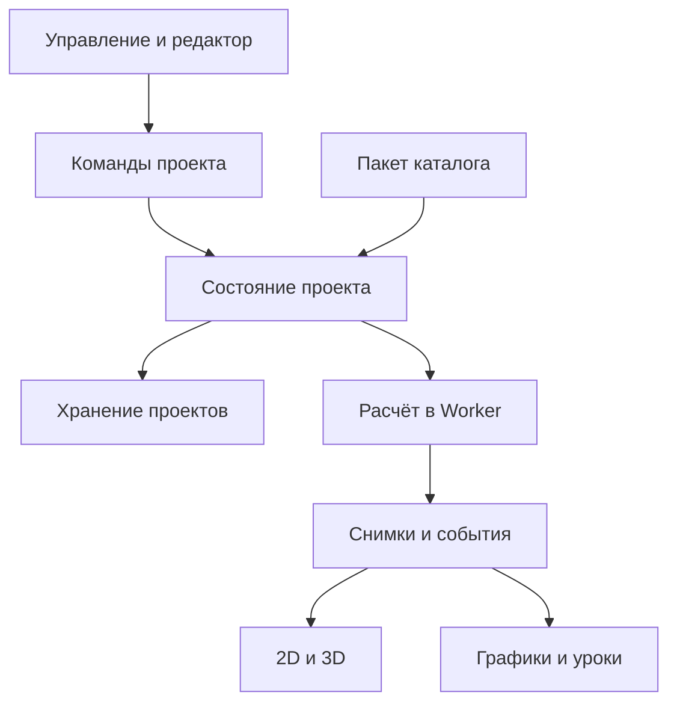

# Волмакс · ТЗ на конструктор водяного тёплого пола

Дата: 26.11.2026. Версия документа 1.4. Базовый товарный периметр для разработки зафиксирован по публичному сайту Волмакс. [Проверка покрытия каталога](2026-11-26-volmax-catalog-coverage.md) фиксирует состав комплектов по опубликованным карточкам, ассортимент сайта и условия проверки паспортных профилей. Разработка начинается от `main` с этим ТЗ и планом. Исходный коммит `de04dad` содержал README. Код приложения появляется на этапе A01. Документ описывает объём релиза 1.0 и решения, принятые для планирования. Оценка времени в плане ориентировочная.

## 1. Назначение и границы

**R01.** Менеджер по продажам моделирует ситуацию покупателя и объясняет, зачем в его схеме нужен конкретный элемент. В конце клиентского кейса он формулирует необходимый следующий вопрос, выбирает оборудование, объясняет причину и называет применимые ограничения. Для готового комплекта умеет объяснить, какие позиции уже входят и какие нужно добавить для выбранной схемы. В одной сессии он может собрать схему, настроить пол и погоду, увидеть движение воды, изменить оборудование, получить измеряемый результат и сравнить его с исходным. Рабочий язык — русский. Базовый пользователь — менеджер со знанием ассортимента без подготовки инженера-проектировщика. Второй пользователь — товарный эксперт или наставник, который готовит проверенные уроки и подтверждает данные каталога.

**R02.** Два режима используют одну модель. В уроке видны цель, текущий шаг, ожидаемое наблюдение и короткое объяснение после эксперимента. Наставник экспортирует ответ и наблюдения для разбора. Скрытый эталонный выбор доступен только после завершения или по явному действию «Показать разбор». Наставник составляет урок как версионированный JSON с локальным валидатором и предпросмотром. Штатные уроки поставляются в пакете. Результаты попыток хранятся в проекте на устройстве, наставнику их можно передать экспортом записи. «Конструктор» открывает все операции, утверждённые для релиза. «Уроки» открывают копию эталонной схемы, у которой автор урока может ограничить допустимые действия на отдельных шагах. Из урока можно сделать отдельный эксперимент с полным доступом. Урок оценивает наблюдаемые действия и результат симуляции. Пояснения связывают изменение параметра с показаниями и практическим смыслом детали.

Что означает «полный конструктор» в 1.0:

- Свободная сборка внутри перечня R01–R19. В одном проекте можно создавать, ставить, подключать, разворачивать, перемещать, дублировать, заменять, отключать и удалять разрешённые типы компонентов. Шаблоны ускоряют старт и остаются редактируемыми. Большинство компонентов допускает несколько экземпляров. Разные экземпляры одного артикула имеют собственные настройки.
- Гарантия автопрокладки для «змейки» и «улитки»: пустой прямоугольник 4×5 м с доступным входом/выходом у стены, проверенной трубой 16×2 мм, паспортно допустимым радиусом и возможным шагом 150 мм. Для ортогональной L-формы поддерживается «змейка» с разбивкой на прямоугольные зоны. Для прочих сложных контуров и вырезов при невозможности раскладки показывается конкретное место конфликта и сохраняется ручная трасса. Петли одного уровня не пересекаются. Магистрали могут пересекаться в проекции, когда разведены по высоте и не образуют соединения без явного фитинга. Трасса учитывает подводки от портов коллектора.
- Полный цикл обучения включает отопление, сервисные демонстрации и контролируемые неисправности. Геометрия комнаты, оборудование, температура и команды действительно меняют расчёт. Одинаковая запись команд даёт одинаковый результат с оговоренным числовым допуском.
- Объём 1.0 — закрытые водяные системы жилого масштаба, отопление пола и радиаторные ветки как нагрузки для смешанной схемы. Теплоснабжение через предусмотренный теплообменник моделируется как два гидравлических домена. Подпитка, сброс и опорожнение имеют отдельные учебные режимы. Результаты предназначены для обучения. Выпуск монтажного проекта, сметы, нормативного заключения и управление реальным оборудованием находятся за пределами релиза.
- Геометрия помещений — прямоугольники и их объединения в одном ортогональном контуре с вырезами, проёмы и прямоугольные запретные зоны. Переходы между уровнями — через стояки. Предлагаемые пределы сертифицируемой нагрузки: 3 уровня, 12 помещений, 6 коллекторных групп, 48 петель, 220 компонентов оборудования и 400 внешних соединений. Уровни нумеруются от 1 до 3. Объект, достигший лимита, сохраняется. При попытке добавить следующий элемент интерфейс показывает лимит и способы освободить место.
- Среда — внутреннее браузерное приложение, основной экран Windows 11, Chrome и Edge двух последних стабильных версий на дату релиза. Рабочий холст от 1280×800 CSS px, на 1024×768 используется сворачиваемая боковая панель. Со смартфона доступны просмотр 2D, каталога и уроков с поддерживаемыми действиями. Свободное рисование и раскладка петель рассчитаны на компьютер с мышью или клавиатурой.

### Варианты реализации и решение

| Подход | Что даёт | Решение для 1.0 |
|---|---|---|
| Заранее анимированные стенды | Быстрое объяснение типовых схем. Количество экспериментов ограничено написанными заранее реакциями. | Применить только как демонстрационную подачу уроков, которые используют общее расчётное ядро. |
| Сеть портов + упрощённая численная модель + Three.js | Свободные схемы, проверяемые реакции, возможность добавлять модели оборудования последовательно. | Выбранная проектная основа. |
| CFD/CAE и точный теплофизический двойник | Подробная инженерная модель с исходными данными, калибровкой и дорогим расчётом. | За пределами учебного релиза. |

По умолчанию 1.0 хранит проекты на устройстве, позволяет перенос через JSON и показывает учебный ассортимент из версионированного релизного пакета. Аккаунты внутри приложения, синхронизация проектов, живой склад, цены, закупка и результаты по сотрудникам не требуются для 1.0. Доступ к внутренней сборке может ограничиваться на уровне хостинга. Публичная сборка может содержать общие уроки, демонстрационные сведения и опубликованные технические данные.

## 2. Пользовательские сценарии и интерфейс

| ID | Требование | Критерий приёмки |
|---|---|---|
| R03 | Стартовая страница с новым проектом, шаблонами, уроками и локальными проектами. Базовые шаблоны: прямое подключение, пол и радиаторы с подмесом, одиночная RTL-петля, два этажа с разделителем, тепловой насос с буфером и теплообменник с разными теплоносителями. | Каждый релизный шаблон открывается, проходит проверку и запускается без ручного ремонта. Кнопка «Использовать шаблон» создаёт отдельный проект. |
| R04 | Вместе работают 2D-схема, 3D-сцена и карточка выбранного элемента. 2D-схема оптимизирована для соединений. 3D — орбита, приближение, вид сверху, прозрачные стены, вид пола в разрезе, переключение уровня, фокус на узле. | Единый выбор и параметры в обеих проекциях. Состояния помечаются цветом и текстом. Масштаб камеры не влияет на расчёт. В 2D доступны все расчётные действия. По действию «Как работает» можно выделить реальный внутренний путь через коллектор, насос, смеситель, обратный клапан, перепуск, предохранительный клапан, расширительный бак и теплообменник. Путь и положение механизма связаны с состоянием модели. |
| R05 | Строительный режим: размеры, зоны, уровни, источник тепла, каталожные компоненты, трубы и сигнальные связи. Рисование труб по точкам с привязкой к портам, свободная трасса, автопрокладка петель «змейкой» и «улиткой», ручная правка. | По изменённому шагу и контуру строится новая черновая укладка с пересчитанной длиной. Долгий расчёт прокладки выполняется вне UI и отменяется. При превышении бюджета сохраняется последняя принятая трасса. Ручную трассу можно сохранить или подтвердить замену. Выход из комнаты, пересечение запретной зоны, неверный шаг и невозможный поворот отмечаются на плане. По невозможной укладке выводится причина, введённые настройки сохраняются. |
| R06 | Редактирование и валидация: карточка товара, положение и крепление, реальные органы управления, настройка учебного отказа, режимы монтажа, работы и обслуживания. | Положение шара видно по ручке, а привод имеет индикатор команды и фактического положения. Крутить можно указателем или полем/клавиатурой. Щелчок по ошибке подсвечивает компонент и порт. Последняя принятая настройка остаётся доступной при ошибке ввода. |
| R07 | Управление симуляцией: запуск, пауза, один вычислительный тик, ускорение ×1/×10/×60/×600, сброс, журнал, просмотр прошлого на графике и сравнение двух снимков А/Б. | Ускорение меняет количество рассчитанных тиков за реальную секунду. Если устройство отстаёт, видна фактическая скорость. История доступна для просмотра. Снимки А/Б могут относиться к разным прогонам и ревизиям. Для одной схемы сравниваются выбранные моменты, для двух схем по умолчанию подбирается одинаковое время от запуска. Видны исходные условия, изменения расхода, температуры, давления и мощности, срабатывания защиты и список добавленных или снятых компонентов. |
| R08 | Климат и состояние: наружная температура, начальная температура воздуха отдельно по комнатам, отдельная уставка воздуха, отдельный лимит поверхности, температура снизу, теплопотери, температура/кривая подачи, исходное давление и теплоноситель. | После запуска текущая температура воздуха становится результатом. Изменение уставки влияет на запрос зоны, а изменение улицы — на потери и погодную автоматику при её наличии. Установка стартовой температуры выполняется через явный перезапуск/новый эксперимент. |
| R09 | Диагностика: направление и скорость движения частиц, цвет воды по температуре, карта поверхности, расход петель, температура подачи и обратки, перепад насоса, избыточное давление системы, мощность, графики, объяснения. | Подпись различает температуру воды, пола и воздуха. При нулевом расходе частицы стоят. При обратном потоке идут в другую сторону. Скорость частиц отражает подписанную скорость жидкости v = Q/A с общим визуальным масштабом. Расход в л/мин отображается отдельно. Легенда указывает ускорение времени и условный масштаб анимации. При неопределённом результате сохраняется отметка времени последнего корректного кадра и его статус. |
| R10 | Эксперименты: снимок перед изменением, временная разборка, закрытие крана, блокировка клапана, сбой датчика/питания, загрязнение фильтра, воздух в петле, снижение работоспособности бака, перегрев и остановка источника, проверка обратного потока. | Любой отказ имеет источник и сбрасываемое состояние. Журнал сообщает «что изменилось → какая величина изменилась → что сработало → как восстановить схему». Включение готового сбоя сохраняет исходную топологию. Монтажная разборка создаёт новую ревизию. Удаление проходного узла размыкает схему. Для урока возможны отдельные действия «заменить участком трубы», «отключить функцию», а для устройства на тупиковом ответвлении — «снять и поставить заглушку». Состояние герметичности проверяется до повторного запуска. |
| R11 | Сохранение в IndexedDB, автоcохранение, именованные проекты, дублирование, экспорт определения и импорт `.json`, экспорт записи урока или эксперимента. | Перезагрузка восстанавливает последнее завершённое сохранение. Импорт проверяется в памяти, показывает результат и сам создаёт копию после подтверждения. Невалидный или слишком новый файл оставляет открытый проект доступным. Конфликт двух вкладок предупреждается и предлагает сохранить отдельную копию. |
| R12 | Каталог ВОЛМАКС и учебные компоненты с поиском по артикулу и названию, фильтрами по функции и присоединению, паспортом и пояснением вклада в систему. | Выбор товара создаёт экземпляр с источником технических параметров. Можно подсветить совместимые порты и заменить экземпляр с предварительным просмотром сохраняемых и отсоединяемых связей. Отсутствие паспортной кривой видно в карточке и результатах. |
| R13 | Уроки с целью, интерактивными подсказками, заданием, измеримым результатом, объяснением и повтором. Релиз комплектуется 15 уроками из раздела 7. Общий первый урок объясняет подачу, обратку, насос и коллектор, запускается в один клик и рассчитан на 5 минут. | В пилоте минимум 4 из 5 новых менеджеров самостоятельно выполняют три базовых урока и решают два из трёх незнакомых клиентских кейсов, верно объяснив выбор, ограничение и состав. Пройденный клиентский кейс включает корректный расчётный результат и отсутствие критичной ошибки подбора. |

### Экран конструктора

Верхняя панель: имя проекта, сохранение, режим и время. Слева: дерево помещений и контуров, шаблоны, каталог. В центре: 2D/3D, инструменты монтажа или запуска. Справа: параметры выбранного объекта и действия. Снизу по запросу: графики, легенда и журнал событий. В режиме урока панель задачи занимает место каталога до перехода в свободный эксперимент. В 2D порты различаются формой и подписью. В 3D детали узнаваемы по геометрии и маркировке, условные модели подписаны в карточке. Для ключевых устройств доступен условный разрез и режим выделения внутренних каналов. Для смесителя видно оба входа и смешанный выход, для обратного клапана — закрытие на обратном перепаде, для предохранительного — путь сброса при событии. Для бака разрез показывает изменение газовой и жидкостной полостей в пределах расчётной модели. В теплообменнике каналы двух сред показываются отдельно. Если форма конкретного изделия неизвестна, разрез помечается как принципиальная схема типа.

Механические рукоятки и управляющая панель вызывают одну команду. Для колёсика, ползунка или слайдера временное предпросмотренное значение и принятое значение различаются. Единицы в интерфейсе: м, мм, м², °C, л/мин, кПа, бар, Вт и кВт·ч. Ввод `1,5` и `1.5` допускается. Пустое поле и бесконечность не меняют принятое значение. Tab, стрелки, Enter, Escape и подписи дают альтернативу управлению мышью. Настройка системы «уменьшить движение» убирает анимацию частиц, сохраняя стрелки и числа.

## 3. Предметная модель и соединения

### Объекты

- `ProjectDocument` содержит `schemaVersion`, `projectId`, `revision`, `catalogReleaseId`, `modelVersion`, `environment`, `rooms`, `components`, `hydronicLinks`, `controlLinks`, `loopRoutes`, `appliedCatalogSnapshots`, `initialConditions` и `viewPreferences`. Запись урока содержит идентификатор и версию урока, исходный JSON, упорядоченные команды и отметки для сравнения. Все идентификаторы устойчивы при переименовании и изменении внешнего вида. Команда получает уникальный ID.
- `Room` хранит полигон, высоту, уровень, U/UA либо конструктор ограждений, теплопередачу пола, тепловую ёмкость, целевое состояние, запретные зоны, места прохода и материал покрытия. Площадь считается по геометрии. Эффективная обогреваемая площадь считается по занятым секциям и может быть меньше общей.
- `ComponentType` задаёт тип модели, доступные свойства, внутренние гидравлические каналы, типизированные порты, способы управления и показатели. `ComponentInstance` задаёт тип, положение, привязку к помещению/уровню, выбранную позицию и настройки. `CatalogProduct` имеет независимый стабильный ID, бренд, модель, артикул производителя и артикул ВОЛМАКС при наличии. Совпадающие артикулы разных производителей не склеиваются. `modelId` и ID товара имеют разные функции.
- `HydronicLink` соединяет два конкретных порта, хранит маршрут, геометрию, материал и сопротивление. Тройник — отдельный компонент с тремя портами. Независимое переключение состояния устройств хранится во времени симуляции. Открытие клапана и закрытие привода могут временно различаться из-за заданной задержки.
- `ControlLink` соединяет совместимые сигнальные порты. Поддерживаются команда «есть запрос», величина датчика, состояние реле и управляющий сигнал привода. На вход допускается один поставщик. Объединение запросов, приоритет и блокировки моделируются явным блоком И/ИЛИ или реле. Команда нагрева действует при наличии питания и всех разрешений. Исправный аварийный ограничитель, подключённый к этому исполнительному входу, имеет приоритет над ручным запросом и термостатом. Разорванная, устаревшая или ошибочная телеметрия получает статус и исполняется по известному паспортному либо учебному правилу отказа. По умолчанию для учебного аварийного датчика потеря сигнала выключает зависимый нагрев с событием. Неподключённый ограничитель на другой ветке не отключает текущую. Циклы управления разрешены только через явную задержку на тик. В остальном статический цикл блокирует запуск с диагностикой.

### Правила соединений и редактирования

**R14.** Совместимость проверяется по физическому домену, типу среды и порта, mating-профилю, резьбе, диаметру и сигнальному типу. Узлы не связываются напрямую через геометрическое пересечение линий. Если присоединение требует переходника, программа предлагает доступную деталь. По умолчанию один внешний гидравлический порт принимает одну связь. Порт под манометр/расширительный бак может быть тупиковым по замыслу. Стрелки назначения порта видны при выборе, а направление расчётного потока определяется моделью и физическим устройством.

Монтаж допускает черновики с ошибками. Расчёт начинается после компиляции схемы. Проект допускает целенаправленное вмешательство на копии урока и позволяет вернуть последнее исправное состояние. Открытый рабочий порт с отсутствующей заглушкой, несовместимое присоединение, смешение двух жидкостных доменов, петля без замкнутого пути и отсутствие теплового источника сопровождаются диагностикой. Полностью изолированная заведомо выключенная ветка отображается с нулевым потоком и пояснением. Герметичная, но физически ошибочная схема (насос против обратного клапана, отсутствие необходимой защиты, недостаточный напор) остаётся доступной для эксперимента с предупреждением либо контролируемой остановкой расчётного шага. Отсутствие бака или группы безопасности допускает ограниченный учебный прогон с фиксацией причины остановки.

Во время запуска можно управлять органами регулировки и вводить разрешённые неисправности. Изменение топологии атомарно останавливает текущий прогон, создаёт ревизию и сохраняет снимок предыдущего. Новый запуск вычисляет исходное состояние по новой схеме. Удаление/замена не оставляют висящих ссылок. Undo/redo действует на проектные команды в истории текущей сессии. Запись эксперимента хранит команды расчётного времени отдельно. Порядок команд на одном тике задаётся `sequence`. Снимок сравнения хранит `runId`, ревизию и неизменяемую ссылку на определение проекта, начальные условия, версии модели и каталога, `tick` и измерения. При разветвлении эксперимента копия сохраняет ID существующих компонентов, новые получают новые ID. Экспорт сравнения включает оба определения и два снимка, а также записи команд при наличии. Сравнение по двум разным временам или начальным условиям доступно с явной подписью.

## 4. Реестр оборудования и материалов

**R15.** Каждая строка обязательна для покрытия релиза. Компоненты «в сборе» могут использовать те же расчётные примитивы внутри. При выборе изделия в сборе интерфейс показывает установленную комплектацию и её паспортные ограничения. Границу между органом управления, параметром монтажа и неисправностью видно в панели.

| Семейство и обязательные варианты | Основные поля и действия | Видимый результат |
|---|---|---|
| Источник тепла: газовый/электрический котёл, тепловой насос, внешняя подача через теплообменник | Уставка, лимит мощности, режим и гистерезис, минимальный расход, наличие встроенного насоса/бака/группы. Для теплового насоса — учебный/паспортный режим и требования объёма, если известны. | Температура, мощность, ограничение расхода, остановка при нехватке условий. Упрощённый режим размораживания только при описанном профиле. |
| Магистраль, стояк, труба петли, теплоизоляция | Длина, внутренний диаметр, шероховатость, высоты, материал, сопротивление изоляции, классификация применения, кислородный барьер. | Потери напора и тепла, объём. Кислородный барьер отражается как характеристика применимости и урок о долговременном риске. |
| Соединения: муфта, угол, тройник, переходник, евроконус, разъёмное соединение, заглушка | Размер, профиль и направление, коэффициент местного сопротивления при наличии. | Герметизация, переход размера, разделение потоков, влияние сопротивления. |
| Коллекторы: подача, обратка, пары с расходомерами/без, коллектор с динамическим ограничением | Количество выходов, размеры и шаг, клапаны и диапазон расходов, порты, торцы и режим регулировки. | Распределение по контурам, шкалы в л/мин, выход из рабочего диапазона регулятора. |
| Балансировочный клапан петли и ветки, отдельный расходомер | Преднастройка, паспортная кривая или типовые значения, диапазон показаний. | Изменение сопротивления, потока в ветке и перераспределение между соседями. |
| Отсечной шаровой кран, клапан петли, моторный зональный клапан | Положение, фактическое открытие, NC/NO для управляемого клапана, время хода. | Изоляция ветки или петли, промежуточное состояние в процессе хода привода. |
| Обратный клапан, дифференциальный байпас, перемычка, RTL-блок | Ориентация и порог, настройка перепада, уставка RTL и ограничение конфигурации по паспорту. | Направленный режим, переток через перепуск, ограничение по температуре обратки у RTL. |
| Циркуляционный насос, прямая насосная группа | Кривая напор–расход, режим фиксированных скоростей/перепада, уставка, привод питания, присоединение и длина установки. | Рабочая точка, нулевой расход при запертой ветви, активные ограничения. |
| Насосно-смесительный узел с насосом и без, двухходовой подмес, трёхходовой смеситель | Порты и направление, кривая клапана, уставка, насос и схема рециркуляции и тип привода. | Доли горячей подачи и обратки, температура смеси, остановка/предупреждение при недостаточном расходе. Узел без насоса требует отдельного устройства, если такова схема. |
| Термоголовка с выносным датчиком, привод смесителя, электротермический привод | Уставка, диапазон положения, время хода, привязка к совместимому клапану, вход сигнала. | Процент открытия, задержка, состояние без питания и при отказе датчика. |
| Термостат воздуха, датчик пола, датчик подачи, наружный датчик, зональный контроллер, погодный контроллер | Уставка, гистерезис, рабочая кривая, распределение зон, задержки, логика запроса источнику. | Измеренная величина, установленная цель, запрос, состояние выхода и реакция подключённых петель. |
| Термостат-ограничитель, аварийное реле | Датчик, порог, гистерезис или ручной сброс, объект отключения. | Прерывание команды насосу/клапану, журнал срабатывания, условия восстановления. |
| Расширительный бак, группа безопасности, предохранительный клапан, манометр | Объём бака, предварительное давление и состояние мембраны, паспортная уставка клапана, узел и высота измерения. | Давление и его изменение при нагреве, защитный сброс и потеря воды в пределах модели. |
| Воздухоотводчик и сепаратор воздуха, концевой блок, краны слива/заполнения, узел подпитки с защитой от обратного тока | Положение, активность, настройка подпитки, условный уровень воздуха, доступность сервисного пути. | События заполнения/слива и развоздушивания, изменение запаса воды и давления. Сервис визуализируется отдельно от рабочего режима. |
| Сетчатый фильтр, грязевик, шламоуловитель и магнитный сепаратор | Коэффициент сопротивления, уровень загрязнения, очистка. | Перепад давления, падение расхода, восстановление после очистки. |
| Гидрострелка, буферная ёмкость, пластинчатый теплообменник | Пары портов, объём, тепловые потери, отдельно первичная/вторичная сторона, UA и сопротивление теплообменника. | Разные расходы, смешение в гидрострелке, накопление тепла в буфере, теплообмен без переноса жидкости. |
| Радиатор (для смешанной системы), термометр, теплосчётчик | Мощность/UA радиатора, уставка, узлы измерения, направление и тип теплоносителя. | Тепловая нагрузка второй ветки, показания температуры, расхода и энергии. |
| Коллекторный шкаф, кронштейн | Размеры, монтаж и место доступа. | Видимость и размещение деталей, конфликт габаритов. |
| Теплоизоляция пола, маты/бобышки, плёнка и подложка, сетка/шины/скобы, демпферные ленты, швы и гильзы | Тепловое сопротивление, слой и способ крепления, шаг установки, линия шва и защита пересечения. Плита с бобышками без изоляционного слоя даёт крепление без подстановки теплового сопротивления утеплённой плиты. | Потери вниз, валидность маршрута, монтажные подсказки. |
| Стяжка, сухие пластины и настил, напольное покрытие | Толщина, теплоёмкость, теплопроводность/сопротивление, допустимая температура покрытия. | Инерция, средняя температура поверхности, локальная иллюстрация различия зон, предупреждение по покрытию. |

## 5. Расчётная модель

**R16.** Симуляция — детерминированная дискретная модель. Гидравлическая сеть рассчитывается в квазистационарном режиме. Переходные процессы воды, пола, воздуха, автоматики и заданных неисправностей обновляются по вычислительному времени. Каждый результат несёт статус, время, единицы и источник параметров. Рабочие уравнения и контрольные примеры проходят инженерную проверку до выпуска.

### Алгоритм и единицы

1. Внутренние единицы — м, с, кг, Па, Вт, Дж, °C и м³/с. Абсолютная температура и абсолютное давление используются там, где это требует формула. UI отдельно маркирует избыточное давление в барах и перепад в кПа. Справочные свойства жидкостей версионируются. Вода и один паспортный/типовой пропиленгликолевый профиль для замкнутого вторичного контура обязательны. Изделие с этиленгликолем остаётся карточкой без расчётного профиля, пока отдельно не подтверждены свойства и применимость. Подменять его пропиленгликолевой моделью нельзя. Свободное химическое смешивание недоступно.
2. Компиляция раскрывает составные устройства и создаёт связные гидравлические домены, тепловые ячейки, контрольные связи. Для каждого герметичного домена задаётся опорное давление. Баланс расходов в сети соблюдается в узлах. Потери труб и местных сопротивлений определяются внутренним диаметром, длиной, свойствами жидкости, расходом и коэффициентами. Насос задаёт подъём давления из паспортной или учебной кривой. Каналы используют подписанные потери с учётом разности высот через гидравлический потенциал p + ρgz там, где плотность в ветке постоянна. Кривая интерполируется внутри паспортного диапазона. В режиме постоянного перепада модель ограничивает результат доступной кривой. Остановленный насос с проходимым каналом оставляет пассивное сопротивление, а встроенный обратный клапан сохраняет своё направленное действие по модели. Работающий насос с запертым контуром может показывать Q = 0 при ненулевом перепаде. Перепуск и обратный клапан используют явные пороги и сохранённое состояние на границе переключения. Выход за диапазон профиля или неустойчивый режим сопровождается диагностикой.
3. На каждом тике: принять команды → обновить состояние датчиков, автоматики, приводов → пересчитать гидравлику при изменении её входов → обновить тепловые ячейки и перенос энергии → обновить запас воды и статическое давление → зарегистрировать допустимые переходы состояний и защиту → опубликовать снимок. Защита регистрирует достижение порога в текущем тике и блокирует только подключённую команду на следующем. На следующем тике предохранительный режим имеет приоритет над ручным запросом. Сброс выполняется по условиям модели, для защёлкивающейся защиты требуется явная команда после устранения причины. Тик модели — 1 с. Численный тепловой решатель имеет подшаги по устойчивости, независимые от кадров Three.js. Контроллер использует последний завершённый снимок. На нулевом потоке перенос тепла по потоку равен нулю, собственный теплообмен ячейки и теплопроводность пола продолжаются.
4. Смешение — по балансу массового расхода и энтальпии. Для одной жидкости с одинаковой теплоёмкостью это взвешенное среднее. В теплообменнике энергии сторон равны по модулю без учёта потерь отмеченной модели. На каждой тепловой ветке: вода → труба → секции пола → помещение и нижняя среда. Буфер рассчитывается как хорошо перемешанная ёмкость с теплопотерями. Заявленный в паспорте режим, требующий стратификации, показывается как приближение.
5. Нагрев пола и воздуха считается по тепловым ёмкостям и связям теплопередачи. Внутренняя температура комнаты меняется по балансу мощности пола, радиатора, потерь через ограждения и вентиляцию. Энергетический баланс прогона учитывает ΔU воды, пола и воздуха, подвод источника, потери наружу, перенос между доменами и энтальпию подпитки/сброса, когда сервисный сценарий включает этот обмен. Внутренний перенос в суммарном балансе взаимно компенсируется. Учебный ввод теплопотерь — Вт/К либо площадь ограждений × коэффициенты. Температура поверхности выводится отдельно от средней температуры массы пола. Локальное поле строится из рассчитанных температур секций с заполнением между ними и помечается «иллюстрация распределения». Для покрытия используется отдельный паспортный порог. Актуальный нормативный профиль имеет ссылку на редакцию, описание условий и дату редакции.
6. Давление в закрытом домене использует начальное заполнение, высоту, тепловое расширение жидкости, рабочий объём и газовую полость бака. Допустимая учебная аппроксимация — изотермический закон с абсолютным давлением и ограничением доступного объёма. Высота и насос дают измерение в конкретной точке. При неизвестной податливости системы без бака модель показывает риск роста давления и границу применимости. Пороговые события «сброс» и изменение запаса воды вычисляются по паспортной/учебной характеристике с ограниченным шагом. При отсутствии данных о сбросе используются только предел и событие. Если податливость неизвестна, численное давление после выхода за область применимости не публикуется. Прогноз разрыва, гидроудар и точная кавитация находятся за пределами модели.
7. Воздушная пробка, шлам, закрытый кран, отказ датчика или питания — состояния модели. Воздух в петле означает добавочное либо блокирующее сопротивление и учебную последовательность развоздушивания. Фильтр меняет сопротивление. Пропажа питания снимает команду согласно NC/NO и задержке. Сервисная модель ведёт баланс заполненного объёма без вычисления распространения свободной поверхности и двухфазного потока.
8. Сингулярные, конфликтующие или не сходящиеся сети завершают шаг за ограниченное число итераций. Снимок остаётся доступным с отметкой «последний рассчитанный», на неисправной ветке выводится причина. Наблюдаемые события привязываются к входным данным и элементам. У значений не бывает `NaN`, бесконечности или числа, тайно подставленного при расчётной ошибке.

### Эталонные проверки ядра

| Код | Фикстура и ожидаемый результат |
|---|---|
| V01 | `Δp = 15 000 × (Q / 1 л/мин)² Па` на каждой из двух одинаковых параллельных ветвей. При постоянном перепаде 15 кПа обе показывают 1,00 л/мин, общий расход 2,00 л/мин. При закрытии одной остаётся 1,00 л/мин на второй. Допуск 0,02 л/мин в числовой фикстуре. |
| V02 | При постоянных 15 кПа коэффициент второй ветви 60 000 Па при 1 л/мин, у первой 15 000 Па. Расходы 1,00 и 0,50 л/мин. При повышении сопротивления первой до 60 000 Па обе показывают по 0,50 л/мин, общий 1,00 л/мин. Та же погрешность. Для отдельной фикстуры насоса с наклонной кривой рабочая точка сверяется с независимым аналитическим вычислением. |
| V03 | Горячая вода 60 °C в объёмной пропорции 1 к 5 с обраткой 30 °C при равных плотности и теплоёмкости даёт 35,0 °C ±0,1 °C. Масса смеси равна сумме входящих массовых расходов. |
| V04 | Одна петля с 1 л/мин воды при `ρ=1000 кг/м³`, `cₚ=4180 Дж/(кг·К)` и падением температуры 5 К передаёт 348,3 Вт ±1 Вт. При закрытии ветви адвективный приток равен нулю. Остаточное тепло воды и массы пола может перераспределяться, поэтому поверхность может кратковременно продолжать нагреваться. На уравновешенной фикстуре без внешнего притока суммарная энергия убывает по потерям. |
| V05 | Тепловой баланс отдельной ячейки `C=1 МДж/К`, `UA=100 Вт/К`, снаружи 0 °C, внутри 20 °C, без источника. Через 600 с `T=20×exp(-100×600/1e6)=18,835 °C` ±0,05 °C. Ускорение не меняет результат по вычислительному времени. |
| V06 | При `Vгаз=8 л`, `pнач=2 бар абс.`, дополнительном поступлении 2 л и одинаковой высоте итоговое давление 2,667 бар абс. ±0,01 бар. Проверочные параметры синтетические. Для клапана дополнительно проверяются событие пересечения уставки, приоритет остановки и баланс потерянной воды. |
| V07 | Нулевая гидравлическая связь через теплообменник при ненулевом теплопереносе. В изолированной ветке расход равен 0. При смене знака перепада обратный клапан закрывается. При закрытых зонах байпас открывается только при наличии перепада выше настройки. |
| V08 | Два прогона одной записи на 600 тиках дают одинаковый порядок событий и расхождение чисел ≤1e-6 в нормированных единицах в одном браузере. Отдельные эталонные сохранения прогоняются в Chrome и Edge с допусками конкретных величин. |
| V09 | На эталонных схемах остаток расходов по узлу ≤ max(0,001 л/мин, 0,1% суммы входов), невязка давления на активном канале ≤ max(20 Па, 0,5% модуля перепада). Баланс энергии за 10 минут для эталонной замкнутой модели ≤1% переданной энергии, с абсолютным допуском 1 Дж при отсутствии передачи. Для приближений обязательно указано основание упрощения. |
| V10 | Синтетическая кривая `H = 30 − 5q` кПа и сеть `Δp = 5q²` кПа при q в л/мин дают `q = 2 л/мин`, `Δp = 20 кПа`. Запрошенные 30 кПа недостижимы на той же максимальной кривой, рабочая точка остаётся 2 и 20 со статусом насыщения. При запирании на фиксированной скорости `q = 0`, `Δp = 30 кПа`. Допуск 0,02 л/мин и 0,15 кПа. Фикстура проходимого отключённого насоса пропускает обратный поток от второго насоса. С обратным клапаном этот поток равен нулю. |
| V11 | Трубы с внутренним диаметром 10 и 20 мм при одинаковом расходе показывают одинаковые л/мин и отношение модулей скоростей 4:1 ±0,02. Направление анимации меняется по знаку. На схеме с двумя насосами разность изменения расхода первой ветки до и после добавления гидравлического разделителя сравнивается с утверждённой контрольной схемой. |
| V12 | Термостат и ручной режим запрашивают нагрев. При пороге срабатывания подключённого ограничителя в следующем тике команда нагрева выключена. При отсоединённом ограничителе ответ отличается и выдаётся диагностика. Защёлка не снимается при сохранении причины. Повтор записи сохраняет порядок и идентификаторы событий. |

Пороги выше — критерии программной проверки и условия фикстур. Рабочие пределы изделий приходят отдельно из паспортов. Данные любого расчёта имеют уровень «по паспорту», «типовая учебная модель» или «данных для вычисления недостаточно». При комбинировании берётся наименее подтверждённый уровень соответствующего вывода. Результаты с учебным профилем нельзя маркировать паспортными.

## 6. Каталог ВОЛМАКС

**R17.** Данные каталога загружаются из опубликованного версионированного пакета JSON. Товарный эксперт может подготовить обновление из CSV в UTF-8 или JSON. Сырой снимок принимает пустые бренд и артикул при наличии устойчивого ID и ссылки карточки. Такие строки остаются в реестре проверки. Учебный элемент с помеченными параметрами доступен в конструкторе. Привязка инженерного профиля к реальному предложению требует подтверждённого сопоставления. Для рекомендации предложения дополнительно проверяется его пригодность в текущей схеме. Пакет содержит инженерные изделия, предложения магазина по каналам и готовые комплекты. Обязательные поля изделия: стабильный ID, статус, бренд, модель, артикул производителя, семейство, `modelId`, порты, параметры, единицы и происхождение критичных данных. Предложение имеет канал, `offerId`, артикул магазина, ссылку, дату проверки и ссылку на изделие или комплект. Комплект имеет отдельный ID и структурированный список `productId`, количество, единицу и источник каждой строки. Дополнительно — фото/условная 3D-модель, паспорт, ссылка на карточку, примечание по комплекту, дата проверки, ограничения. В базовом релизе каталог обновляется через репозиторий и релизный пакет, а пользователь может предварительно просмотреть подготовленный пакет в локальном режиме.

Для каждого параметра хранятся `value`, `unit`, `basis` (`datasheet`, `generic`, `unknown`), `sourceRef` и `reviewedAt` для проверенной записи. Кривые хранят измеренные пары в допустимом диапазоне и версию профиля. Импорт сверяет дубликаты, типы единиц, обязательные признаки, монотонность паспортных кривых в пределах принятой модели, заполненность ссылок и сопоставление модели. Отбрасывать строку с ошибкой молча нельзя. Пакет активируется целиком после проверки. Архивная позиция остаётся доступной в уже сохранённом проекте. Переход на новый профиль — отдельное действие с просмотром отличий. Идентификаторы товарного предложения и инженерной модели не зависят от URL карточки.

Каждая строка набора имеет версию и происхождение. Встроенный в коллектор элемент отражается в модели и отмечается «входит в сборку». При разворачивании комплекта количества сверяются с карточкой. Одна и та же функция в комплекте и в составе устройства не создаёт дублирующий физический узел. После выбора шаблона программа показывает «в комплекте», «нужно отдельно», «может потребоваться по условиям» и «уже установлено». Расчёт работает по фактически добавленным деталям. Для учебного показа состава источником служит опубликованный перечень конкретной карточки со снимком даты. Состав снимка хранится в `compositionAsPublished`. Противоречие с общим описанием серии хранится в `ambiguity` и отображается при выборе. Флаг `recommendationEligible` зависит от подтверждённой комплектации и профиля. Решение товарного эксперта версионируется с датой и не стирает опубликованный источник.

[Матрица покрытия каталога](2026-11-26-volmax-catalog-coverage.md) задаёт перечень семейств, снимок публичной витрины и точные составы всех 21 комплектов из её раздела. Для утверждённого периметра требуется 100% решений по строкам, 100% типов раздела 4 в учебной библиотеке и все зависимости шести схем и пятнадцати уроков. Для предложений, участвующих в подборе, требуется ноль `unresolved`. Отложенные предложения вне подбора сохраняются в реестре с причиной, владельцем и датой решения о выводе из релизного подбора. Для позиций без подтверждённого предложения используется маркировка «учебный элемент». [Сверка 224 смежных карточек](volmax-site-applicability-2026-11-26.csv) применяется к исходному снимку по `offer_id`. `usage_context` и `engineering_role` — пояснения для пользователя и проверки данных. В рабочем пакете тип прибора задаётся стабильным `componentTypeId`, а сценарии размещения — списком `allowedContexts` из значений `floor_loop`, `floor_mixing`, `heating_distribution`, `radiator_branch`, `fill_service`, `mounting_accessory`. Тип и разрешённый контекст дополняют проверку портов, направления, среды и размеров по R14. Контекст берётся из выбранного узла или роли ветки и проверяется по топологии. В черновике контекст может быть неизвестен. До подтверждения схема помечает подключение как требующее уточнения и блокирует расчёт с ним. Редактор и компиляция используют одно правило, включая загрузку проекта. Элементы `mounting_accessory` без гидравлической функции крепятся к объекту без добавления канала. `hold` и `excluded` недоступны для добавления из каталога.

Аудит применимости определяет предварительную роль. Для подключения товарной карточки нужны подтверждённый тип, контекст и профиль совместимости. При нехватке данных из карточки доступен переход к отдельному учебному аналогу. `basis` показывает уровень источника роли. Из `sales_gate` и `clearance_on_source_card` импортируется условие дополнительной проверки. Флаг `recommendationEligible` становится доступен только после подтверждения идентичности изделия, паспортного профиля и, где применимо, комплектности и статуса предложения. В текущей схеме дополнительно проверяется применимость по R14 и рабочим параметрам. Наличие документа производителя о роли само по себе этого флага не устанавливает. Профиль GAPPO G1494 относится к воздушной регулировке локальной петли. G1495 отображается как ограничитель теплоносителя. Пока не подтверждены точка измерения на обратке и схема подключения, карточка не занимает место RTL и не рекомендуется для этой роли. L05 и L14 используют отдельный учебный профиль RTL с проверенным принципом работы по температуре обратки. Источник принципа работы — паспорт FHV-R в списке источников. Опубликованные карточки служат начальным набором разработки. `volmax.ru` — исходный товарный канал 1.0. Позиции других каналов включаются по подтверждённому сопоставлению. Технические поля и продажные рекомендации проходят проверку на E01/G02. Если параметра нет, конкретному товару не приписывается паспортная характеристика. При подготовке закрытой версии текущий список предложений и разрешённые закрытые профили доставляются отдельно.

### Правила входных полей

| Величина | Предлагаемая область ввода и поведение |
|---|---|
| Комната, размеры | Координаты в метрах, прямоугольник от 1×1 до 30×30 м, высота 2–6 м. Для сложного контура проверяются замкнутость, отсутствие самопересечения и габариты в пределах 30×30 м. Комнаты уровня не перекрываются. Допускается смежная граница. |
| Укладка | Шаг 50–400 мм при соблюдении минимального радиуса конкретной трубы. Продолжительная петля может быть создана для эксперимента, если геометрия допустима. Превышение паспортной или учебной длины создаёт предупреждение. |
| Температура | Улица −45…+35 °C, воздух в начале 5…35 °C, уставка воздуха 5…35 °C, начальная вода 5…80 °C, уставка источника 5…90 °C, при этом совместимость с элементами проверяется по паспорту и учебному режиму. Температура подачи 60–90 °C допустима как осознанный урок нарушения в ветке пола с явным событием. |
| Параметры оборудования | Ручки и шкалы используют диапазон и шаг модели. Критичные параметры из карточки фиксируются для конкретного SKU. В режиме эксперимента разрешено скопировать экземпляр в учебный и изменить доступный параметр с пометкой происхождения. |

## 7. Учебные сценарии

Урок имеет ID и версию, исходный проект, цель, ожидаемые действия, машинный критерий, объяснение, время и подсказки. Карточка каждой модели содержит назначение, наблюдаемый признак работы, условие применения, ограничение и типовую ошибку покупателя. Для модели можно открыть заранее настроенный пример либо найти соответствующий элемент в уроке. Отдельная кнопка сбрасывает попытку к исходному состоянию. Сдача урока выражается понятным объяснением, чей клапан сработал и какой параметр изменился.

| ID | Что делает менеджер | Что проверяет урок |
|---|---|---|
| L01 | Запускает прямую систему, находит подачу, петлю и обратку. | Выбраны три нужных элемента, расход положительный, трасса подсвечена. |
| L02 | Балансирует две неравные петли. | Оба расхода в пределах ±10% от индивидуальных целей фикстуры. Зафиксировано положение регулируемого канала. |
| L03 | Подключает обогрев двух петель к одному термостату. | Обе петли реагируют на запрос, независимая соседняя зона сохраняет управление. |
| L04 | Настраивает подмес горячей радиаторной подачи. | После перехода температура подачи пола в пределах учебной уставки ±1 °C, радиаторная ветка работает, видна доля подмеса. |
| L05 | Устанавливает RTL в одиночной петле. | Клапан реагирует на температуру обратки, сравнение объясняет отличие от контроля подачи. |
| L06 | Закрывает все зоны и изучает байпас и отключение насоса. | Видны три состояния: запертая сеть, перепуск, остановка по отсутствию запроса. |
| L07 | Сравнивает коллектор с воздухом, засорённым фильтром и чистой линией. | Система различает локальный нулевой расход и общее падение расходов, соответствующее обслуживание улучшает результат. |
| L08 | Имитирует недоступный бак, затем корректное восстановление, изучает предохранительный клапан. | Помечены рост давления или достижение границы модели и срабатывание защиты для расчётной фикстуры. Сброс виден в журнале, если характеристика позволяет его моделировать. |
| L09 | Пропускает через пол горячую воду и сравнивает состояние с ограничителем и без него. | Фиксируется нарушение допустимой температуры подачи и отработка заданного отключения. При отсутствии защиты отображается остановка при выходе за пределы модели. |
| L10 | Сравнивает два этажа с разными насосами до и после добавления разделителя и обратного клапана. | Есть наблюдаемый переток в исходной схеме при условиях фикстуры. Разделитель снижает взаимное влияние, обратный клапан закрывает обратный путь в своей ветке. |
| L11 | Сравнивает тепловой насос при закрытии зон с буфером и соответствующей обвязкой и без них. | В одной схеме срабатывает ограничение минимального расхода, в другой выполняются условия по расходу и водяному объёму. Показана причина. |
| L12 | Сравнивает мокрый и сухой пол, затем меняет погоду и покрытие. | Графики показывают различную тепловую инерцию и мощность. Уставка воздуха и допустимая температура покрытия отображаются отдельно. |
| L13 | Клиент жалуется на холодную дальнюю петлю. Проверяет короткую и длинную петли, экспериментирует с балансировкой и насосом. | По расходам и температуре находит причину из данных кейса. Подбор насоса с большим максимальным напором без проверки рабочего режима не засчитывается. Даёт короткое объяснение покупателю. |
| L14 | У клиента радиаторы и один санузел. Уточняет температуру подачи, площадь/геометрию одной петли и способ регулирования. Сравнивает допустимый RTL и узел подмеса по двум входным вариантам. | Оба решения проверяются по рамкам конкретного паспорта и учебной схеме. Менеджер объясняет, что ограничивает каждый вариант и почему условия второго варианта меняют ответ. |
| L15 | Выбирает готовый комплект для нескольких комнат, где количество комнат отличается от числа петель. Разворачивает комплект, выбирает недостающие позиции и проверяет кандидат на смену насоса. | Проверены число контуров, состав и количества, наличие отдельных петель/трубы, совместимость 130/180 мм, различие насоса в комплекте и узла без насоса. Корректное изделие с неверным объяснением остаётся частичным успехом. |

В L13–L15 оцениваются четыре поля: исходное уточнение, выбор (включая отказ от лишней покупки), объяснение и проверка ограничения или состава. Машинные критерии читают события и структурированный ответ. Свободную фразу проверяет наставник по рубрике. «Правильная деталь, но неверная причина» и «технически рабочая схема с лишней покупкой по условиям кейса» имеют отдельные отрицательные фикстуры. Пилот использует скрытые варианты исходных данных.

## 8. Архитектура, сохранение и выпуск

**R18.** Предлагаемый стек: TypeScript strict, React, Vite, npm с версионированным lockfile, Three.js, Vitest, Playwright, IndexedDB, GitHub Actions. Фиксируются выбранные совместимые версии и обновляются отдельными PR. Расчётное ядро на TypeScript без DOM, React и Three.js. Для браузера ядро загружено в Web Worker. UI передаёт сериализуемые команды с ревизией, Worker возвращает снимки и события. Данные каталога и проектов проходят runtime-валидацию. Модели деталей — процедурные и/или лицензированные GLB по согласованному справочнику. Ассеты на релизе поставляются вместе с приложением.

- `project`, `catalog`, `simulation`, `worker`, `editor`, `views`, `lessons`, `storage` и `app` имеют отдельные обязанности. Рендер читает подготовленные DTO и не меняет состояние расчёта. Хранилище работает с версионированными DTO, этап симуляции не делает обращений к сети. Логика подсказок уроков потребляет те же события, что и свободный эксперимент.
- Версии данных: `schemaVersion` для структуры, `modelVersion` для правил, `catalogReleaseId` для источника характеристик, `lessonVersion` для сценария. Релизный snapshot каталога берётся из проекта. Проекты N−1 открываются миграцией с резервной копией. Схема из будущей версии может быть сохранена в исходном виде, клиент объясняет, какой версии приложения не хватает. Запись с неподдерживаемой версией расчёта доступна для просмотра сохранённых результатов. Пересчёт — отдельный переход с явным предупреждением.
- Хранение проекта и ревизии атомарное. Проверка ревизии и запись в одной операции IndexedDB. Успех сохранения показывается после завершения транзакции. Ограничения: импорт до 10 МиБ, 20 000 команд на одну запись, графики до 2 000 точек на ряд с сохранением экстремумов и отдельных событий. При превышении квоты доступен JSON-экспорт и управление сохранениями. Автосохранение через 500 мс от последнего принятого изменения, модель продолжает работать при сбое записи.
- Рабочие цели на типовом ПК Intel Core i5-1235U, 16 ГБ RAM, встроенная графика, 1920×1080, DPR до 1,5, браузер без открытых тяжёлых вкладок. Небольшой эталон: 1 комната, 2 петли. Большой: 12 комнат, 48 петель, 6 групп, 220 компонентов и до 400 соединений с профильной нагрузкой. Допустимо до 1024 точек на маршрут, до 16 384 точек всех маршрутов, до 10 000 тепловых ячеек, до 2048 одновременно рисуемых частиц. Перед выделением ресурсов проверяются пределы. Превышение лимита тепловой дискретизации приводит к укрупнению сетки с индикацией. Редактор держит предыдущую валидную геометрию, пока новый маршрут не принят. Время до первого интерактивного экрана при холодной загрузке контрольного пакета ≤4 с при условном соединении 20 Мбит/с и RTT 50 мс. В большой сцене p95 кадра ≤33 мс на 30 с движения камеры. p95 реакции редактора на действие ≤150 мс без пересчёта трасс, подтверждение команды управления при ×1 p95 ≤500 мс на малом эталоне и ≤1 с на большом. Первый расчётный снимок с учтённой командой появляется на следующем тике, с целевой задержкой p95 ≤1,5 с на малом и ≤2 с на большом. Физическая задержка привода показывается отдельно. При низкой производительности уменьшаются количество частиц и качество теней. Потеря GPU переключает в 2D с сохранением проекта. В производительности оценивать реальное время, а не скорость симулируемого процесса.
- Импорт проверяет размер, типы, длины строк, числовое представление, уникальность ID, связи, количество компонентов и глубину структуры до построения сцены. Текстовые поля показываются как текст, ссылки — только разрешённые протоколы `https:` и локальные ссылки на ассеты. Проекты не передают исполняемый код. На хостинге устанавливаются подходящие CSP и ограничения доступа, если выбрана закрытая доставка.

**R19.** Продакшен включает статический HTTPS-хостинг, предпросмотр сборки и выпуск неизменяемого артефакта из GitHub Actions, версию сборки и каталога в UI, журнал изменений, процедуру отката и проверку на целевом хосте. Базовая рекомендуемая модель — статическая сборка `dist` на хостинге Волмакс, отдельные staging/production и доставка одного проверенного артефакта. Для публичного обезличенного набора возможен GitHub Pages, где путь `base` должен соответствовать расположению. Выбор целевого URL и способа ограничения доступа подтверждает владелец до настройки выпуска. Внутренний пакет и результаты сотрудников никогда не включаются автоматически в публичные сборки.

Критерии выпуска:

1. Все R01–R19 имеют задачу, тест или демонстрацию, каждый тип из раздела 4 и все шаблоны работают в своей схеме. 15 уроков доступны в релизном пакете. Матрица состава и покрытия каталога закрыта на утверждённую дату.
2. Фикстуры V01–V12 проверены, контрольные схемы и объяснения подписаны ответственным специалистом по отоплению. Проверка паспорта и сопоставление артикула имеют владельца и дату. Нет критических расхождений с эталонами.
3. Пройдены сценарии из раздела 7, сохранение/восстановление проекта, миграция, поломка WebGL, повреждённый импорт, конкуренция вкладок, ошибки конфигурации и контрольная нагрузка. Проведён пилот R13, результаты добавлены к релизной карточке.
4. Артефакт проходит `npm ci`, линтер, проверку типов, unit/integration, e2e и `npm run build` с чистой рабочей копии. В staging и production сверяются совпадающие SHA-256 сборки и, при закрытой доставке, отдельного пакета каталога. Закрытый пакет поступает из защищённого источника хранения через релизный контур с правом чтения у исполнителя. Публичный CI и публичный пакетный артефакт его не получают. Доступ, сохранение и откат проверены. Назначены ответственные за каталог, предметную проверку и выпуск.

### Техническая готовность

**Вывод.** Можно начинать с A01, затем реализовать формат проекта, геометрию и расчётное ядро на числовых фикстурах. Для старта каталога есть датированный снимок volmax.ru, 21 состав комплекта и решения по 224 карточкам. Предметная проверка моделей запланирована на C02, проверка продаваемых SKU и пилот — на G02, выпуск — на G03. Семь отложенных карточек, доступы к хостингу и данные дополнительных каналов не требуются для A01–A04.

**Область изменений.** Новые редактор, проектный формат, каталог, расчётное ядро, два вида, обучение, локальное сохранение и выпуск. Важные инварианты — целостность графа, физические балансы, происхождение параметров и переносимость проектов.

**Технический дизайн.** Контракты компонентов, потока данных и версий описаны в разделах 3–8.

**Порядок реализации.** [Пошаговый план и зависимости](../plans/2026-11-26-volmax-educationsim-plan.md).

**Верификация.** Контрольные расчёты V01–V12, уроки L01–L15, отказоустойчивость браузера, пилот и приёмка выпуска.

### Решения и входные данные, которые подтверждаются до выпуска

| Решение | Пока заложено в ТЗ | Где потребуется подтверждение |
|---|---|---|
| Источник каталога и состав первого релиза | Официальные документы производителя, снимок volmax.ru от 26.11.2026 и отдельный учебный тип при неполном паспорте. Выгрузка нужна для дополнительных каналов. Сверен карточный состав 21 комплекта. Общее описание «Эко» противоречит всем 10 проверенным карточкам серии. В симуляции отображается конкретная карточка, фактическая комплектовка проверяется до продажной рекомендации. | До приёмки каталога и уроков с артикулами. Разработка формата и функциональности начинается с опубликованных примеров. |
| Хостинг и доступ | Внутренний статический HTTPS, локальное хранение, отдельный staging. | До проверки выпуска: домен, видимость, доступы и ответственный. |
| Точность и содержание | Учебная модель с явными границами, фиксированные критерии R13/V01–V12 и ручная инженерная проверка. | Перед допуском в production. Ответственного согласует владелец проекта. |
| Целевые устройства и лимиты | Windows, Chrome/Edge, контрольный масштаб раздела 8. | Во время пилота зафиксировать реальные машины и измерения. |

## Источники

- Росстандарт, ГОСТ Р 70834-2023. [Карточка стандарта](https://protect.gost.ru/gost/details/019bf528-1fcc-4ceb-9b84-0fec3cfec119). СП 60.13330.2020, раздел 14 и приложение Б. [Текст с редакцией](https://rags.ru/documents/prod/metodika/0/sp_60.html).
- Caleffi, гидравлика и смешение. [Hydronic Fundamentals](https://www.caleffi.com/sites/default/files/media/external-file/Idronics_12_NA_Hydronic%20fundamentals%20.pdf), [Mixing in Hydronic Systems](https://www.caleffi.com/sites/default/files/media/external-file/Idronics_7_NA_Mixing%20in%20hydronic%20systems.pdf) и [компоненты тепловых насосов](https://www.caleffi.com/sites/default/files/media/file/03313_EN_COMPONENTS%20FOR%20HEAT%20PUMP%20SYSTEMS.pdf).
- Uponor, [Complete Design Assistance Manual](https://www.uponor.com/getmedia/4041336b-03b0-43ce-b8dc-b8f1e796f888/cdam-manual-full.pdf?sitename=USA). Danfoss, [паспорт FHV](https://assets.danfoss.com/documents/latest/105319/AI000086446978en-010101.pdf). Grundfos, [ALPHA/UPSe](https://www.grundfos.com/content/dam/local/en-us/activity-assets/domestic-cold-water/downloads/Grundfosliterature-6512580-UPSe-ALPHA-data-booklet.pdf).
- RTP, [каталог](https://rtp.ru/upload/katalog.pdf) и [технические паспорта](https://rtp.ru/information/tech-passports/). VALTEC, [настройка COMBIMIX](https://valtec.ru/document/article/nastrojka-uzla-combimix.html).
- [Three.js OrbitControls](https://threejs.org/docs/pages/OrbitControls.html), [Three.js Raycaster](https://threejs.org/docs/pages/Raycaster.html), [Vite Static Deploy](https://vite.dev/guide/static-deploy.html) и [GitHub Actions deployment environments](https://docs.github.com/en/actions/concepts/workflows-and-actions/deployment-environments).
